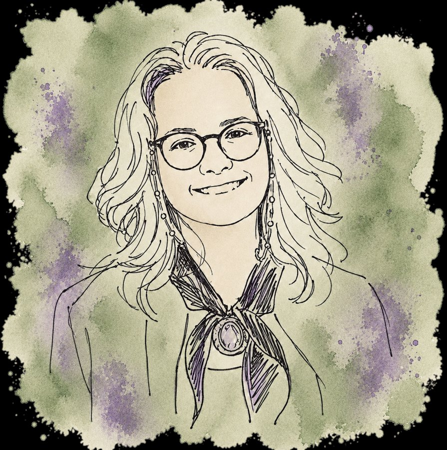

## Rowan R. Terra

Rowan R. Terra is a computational biogeochemist. Rowan successfully defended a Ph.D. in Biological Sciences at Duquesne University in October 2026, co-advised by Dr. Nancy Trun at Duquesne University and Dr. Djuna Gulliver at the Department of Energy National Energy Technology Laboratory (DOE-NETL). In November 2026 Rowan joined the DOE-NETL HERMES initiative as an ORISE Postdoctoral Research Fellow. Rowan plans to move into industry in 2027 and is excited to broaden the range of projects Terra Cognita LLC takes on.

Their doctoral research focused on the coupled geochemical and microbial controls on metal mobility and critical mineral recovery in abandoned mine drainage (AMD) systems, with particular emphasis on 3d- and 4f-block metals in Appalachian coal basins. Rowan integrates environmental microbiology, chemistry, and data science to develop holistic frameworks for understanding and predicting microbe–metal interactions in mining-impacted environments.

Rowan’s commitment to multidisciplinary research has led to collaborations across multiple departments and institutions. During their Ph.D. studies, they prioritized research training and skills development of undergraduate and graduate students in the lab, resulting in numerous students contributing as co-authors on peer-reviewed publications and manuscripts in preparation.

<!-- cv-link -->

---

## Students Mentored

*Institutional affiliations reflect appointments during time of mentorship.*

† Contributed significantly to a published manuscript.  
‡ Contributed significantly to a manuscript in preparation or under review.

| Name | Department | Institution | Years |
|------|------------|-------------|-------|
| **J. Bowman ‡** | Computer Science | Duquesne University | 2026 |
| **I. Cann ‡** | Biological Sciences | Duquesne University | 2023–2026 |
| **C. Crawford ‡** | Computer Science | Duquesne University | 2026 |
| **N. Dalgaard ‡** | Computer Science | Duquesne University | 2026 |
| **P. DiGirolamo ‡** | Computer Science | Stevens Institute of Technology | 2025–2026 |
| **K. Kelly ‡** | Biological Sciences | Duquesne University | 2025–2026 |
| **T. Kellman ‡** | Environmental Science | Duquesne University | 2026 |
| **M. Lamke** | Biological Sciences | Duquesne University | 2025–2026 |
| **C. Pugh** | Biological Sciences | Duquesne University | 2025–2026 |
| **J. Rahman ‡** | Computer Science | Duquesne University | 2026 |
| **A. Strassner** | Biological Sciences | Duquesne University | 2025–2026 |
| **R. Sumner** | Biological Sciences | Duquesne University | 2025–2026 |
| **M. Meinzer** | Psychologie und Psychotherapie | Technische Universität Braunschweig | 2024 |
| **A. Thiele** | Psychologie und Psychotherapie | Technische Universität Braunschweig | 2024 |
| **N. Lamagna ‡** | Biological Sciences | Duquesne University | 2022–2023 |

---

## Principal Investigators and Mentors

*Institutional affiliations reflect appointments during time of mentorship.*

| Name | Role | Area of Expertise | Institution |
|------|------|-------------------|-------------|
| **N. Trun, Ph.D.** | Doctoral Co-Advisor | Microbiology | Duquesne University |
| **D. Gulliver, Ph.D.** | Doctoral Co-Advisor | Geomicrobiology | National Energy Technology Laboratory |
| **C. Lopano, Ph.D.** | Research Mentor | Geochemistry and Minerology | National Energy Technology Laboratory |
| **K. Kokka, Ed.D.** | MAT Advisor | STEM Education | University of Pittsburgh |
